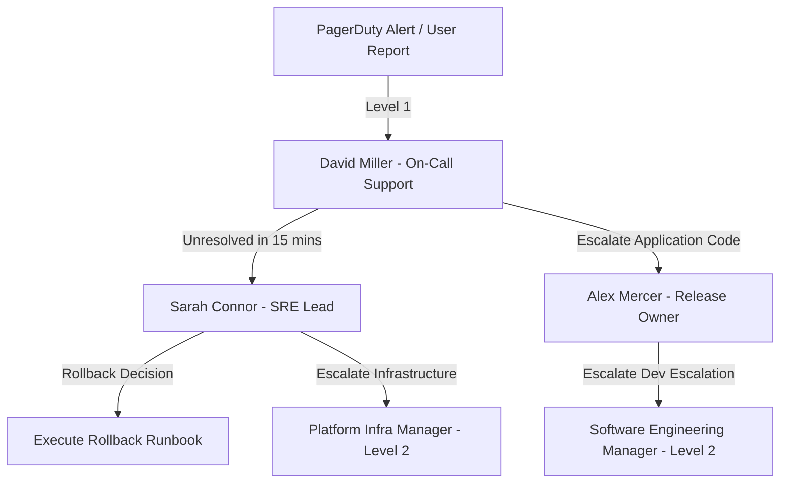

# Deployment Ownership Matrix

This document defines the ownership roles, on-call support team, and escalation pathways for the Checkout API v2.4 deployment window.

## 1. Deployment Window Details
- **Proposed Target Deployment Date**: 2026-08-27 (Pending "Go" approval)
- **Deployment Window**: 02:00 AM – 04:00 AM UTC (Off-peak maintenance window)
- **Target Environment**: Production (Cluster: `prod-us-east-1`, Namespace: `checkout-system`)

---

## 2. Ownership Roles & Responsibilities

| Role | Assigned Name | Team / Department | Responsibility |
|---|---|---|---|
| **Release Owner** | Alex Mercer | E-Commerce Dev Team | Author of the code changes. Triggers deployment, monitors primary business metrics, and coordinates SRE approvals. |
| **SRE / Operational Lead** | Sarah Connor | Site Reliability Eng (SRE) | Oversees cluster health, validates infrastructure manifests, approves configuration variables, and executes rollback if triggered. |
| **On-Call Support Engineer** | David Miller | Platform Operations | Monitors alerts during the deployment window and handles immediate traffic routing. |
| **Database Administrator (DBA)** | Elena Rostova | Database Infrastructure | Monitors PostgreSQL database health, connection pool metrics, and transaction load spikes. |

---

## 3. Communication & Escalation Pathways

During the deployment window, the team will communicate on the Slack channel `#ops-releases-checkout`. 

### Escalation Protocol
If an incident is triggered post-deployment (e.g., HTTP 5xx spikes, database connection starvation, memory leaks) and cannot be resolved within **15 minutes** by the primary on-call team, SRE Lead Sarah Connor will declare a rollback.

### Escalation Contact Directory

- **Level 1 Support**: David Miller (Ops) - PagerDuty ID: `P-DMILLER-3829`
- **Level 1 Application Escalation**: Alex Mercer (Dev) - Phone: `+1-555-019-3904`
- **Level 1 Infrastructure Escalation**: Sarah Connor (SRE) - Phone: `+1-555-019-4820`
- **Level 2 Emergency Incident Commander**: Platform Engineering Manager - Slack: `@john.ops`
